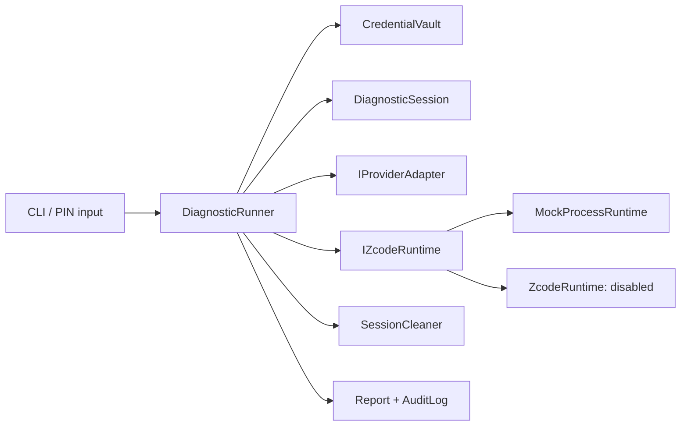

# 架构

RDT 是独立凭据与运行生命周期包装层。Agent 属于外部 runtime，RDT 不实现 Shell、工具执行器或推理循环。

`Rdt.Core` 不依赖终端 UI。`ISecretInput` 支持无真实凭据测试；`IProviderAdapter` 只负责受控临时配置；`IZcodeRuntime` 接收 session、启动回调和取消 token，返回退出码及取消状态。真实 runtime 与 Mock 的报告标识不同。

生命周期：

1. CLI 提示 PIN，Core 创建独立报告与启动审计。
2. 解锁版本化凭据。立即擦除 PIN 数组。
3. 创建 `%TEMP%\RDT-<GUID>`，写所有权标记，保持排他租约。
4. 写运行限制与 G provider 配置；擦除 RDT 持有的解密数组。
5. runtime 使用无 shell 的参数列表启动；启动回调记录真实启动状态。
6. 等待正常退出或取消。取消时先停止子进程树，再等待退出。
7. finally 释放租约，验证并删除 session。
8. 写清理与退出审计，生成 summary。报告导出失败也不会绕过已经执行的 session 清理。

`Report` 在 session 树外，cleanup 从不接收报告路径或任意通配删除指令。并发报告目录加入随机后缀。`AuditLog` 没有自由文本字段或异常序列化接口，只有枚举事件、错误码、版本、Provider、模式、时间、session ID、退出码。

`ReadOnlyPolicy` 构建固定上游参数：plan、移除危险工具、workflow disabled，环境白名单重建。没有传透参数、任意 executable CLI 参数或模式切换。源码中的 denylist 是待验证契约，不能覆盖未知上游新增工具，所以 `ZcodeRuntime` 强制拒绝启动。

Mock 启动的是 RDT 自身的测试 child。它读取实际生成的隔离配置、验证模式和环境，然后输出固定无秘密结果。它不会调查客户电脑或联网。自动化测试既有进程级验收，也有故障注入；不使用“模型说成功”作为证据。

发布边界：Core + CLI 可发布 win-x64 self-contained 目录；无需客户开发环境。外部 Agent 的 Node bundle/SEA、许可证材料、版本固定及只读能力校验属于下一阶段，不能从 RDT 的自包含发布推导出完整 Agent 已便携化。
